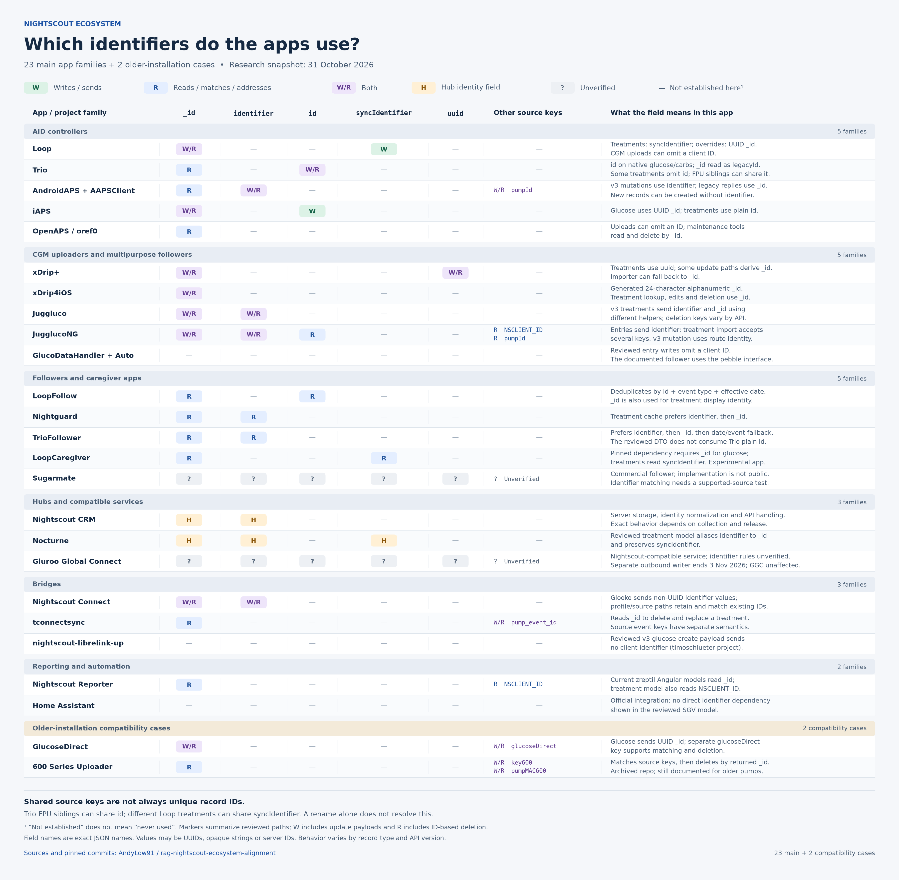

# Nightscout identifier alignment proposal

**Published for community discussion by Andy Low, 31 October 2026. Ecosystem agreement is pending.**

The proposal separates the server's storage identity from an uploader's record identity, recommends `identifier` as the common API field, and preserves compatibility with existing apps and data during migration. Ben's response identifies conflict and resend behavior, including merge versus replacement, as the next discussion.

This page records the Discord posts supplied by Andy. The times below are the displayed Discord times; no message permalinks or timezone were supplied. Wording is retained, with spacing and list numbering normalized and role icons omitted. The contextual notes after the posts are separate from the published text.

Related material: [migration plan](ecosystem-identifier-migration-plan-2026-10-31.md), [ecosystem research](../60-research/tenancy/ecosystem-identifier-compatibility-2026-10-31.md), [extended audit](../60-research/tenancy/ecosystem-identifier-compatibility-2026-10-31/extended-audit.md).

## Published rationale at 21:11

Andy Low:

> Here's my brain dump so far. To quote Simon Sinek, Let's "Start With Why", otherwise, everything is pointless.
>
> 1. My understanding is that the reason is three-fold:
>    1. Separate server identity from app identity. Nightscout owns `_id`; the uploader’s UUID or other stable identifier belongs in a separate field. This keeps one field from serving two different purposes.
>    2. Apps shouldn’t need a cached server ID to manage their records. They may still cache and use `_id`, but losing that cache, or uploading from another device, shouldn’t prevent reliable retries, edits or deletion. Their stable client identifier provides another way to address the record.
>    3. Match records by identity, rather than assuming matching attributes mean the same event. Within a collection. e.g. Right now, Nightscout uses `created_at` and `eventType` as part of it's de-duping, and that's potentially bad news.
> 2. I've used AI to read Ben's initial assessment, and to do some further searching across the ecosystem. Focussing on the main players here (hopefully no-one is offended by the term - soz!) Here's a simplified graphic that hopefully shows it clearly.

## Published alignment proposal at 21:24

Andy Low:

> So the first part of the proposal is that no-one writes new data to Nightscout/Nocturne with `_id` as their identifier (thanks **@Dan C.** for already implementing this part into Trio!)
>
> But the next part is to try to get everyone to use the same identifier so everyone is aligned.
>
> Apps in isolation would continue to work independently without this alignment piece, but it could benefit the community as a whole to align, for various reasons:
>
> 1. Less app-specific handling: Nightscout, Nocturne, followers and reporting tools would have one documented way to recognise record identity.
> 2. More predictable syncing: retries, updates and deletion could follow the same contract across apps and servers.
> 3. Better support for multiple uploaders: a watch, phone or bridge uploading the same sensor reading could address the same record, provided they derive the same identifier value.
> 4. Easier maintenance and new integrations: developers could implement and test one shared contract, with fewer special cases and compatibility surprises.
>
> The shared field name is only one part of that agreement. We also need clear rules about what an identifier represents and when two uploads should count as the same record.
>
> Apps could retain their internal naming, with existing upload fields supported during a gradual migration.

## Ben's response at 21:29

bewest:

> if Andy check that into alignment main, it should produce a shareable page/link. if this is part 2, then part 3 will be agreeing on conflict/resend merging, vs replacing. I experimented with json+merge (sending null deletes a property) but wound up having to go with replace to keep backwards compat.

## Graphic shared at 21:37

Andy also shared the identifier graphic. The repository version below contains 19 project families: 18 main families and GlucoseDirect as an older-installation compatibility case. It shows reviewed current behavior against the proposed server-owned `_id` rule.

[Full resolution PNG](../60-research/tenancy/ecosystem-identifier-compatibility-2026-10-31/identifier-map.png) · [Editable SVG](../60-research/tenancy/ecosystem-identifier-compatibility-2026-10-31/identifier-map.svg) · [Evidence and qualifications](../60-research/tenancy/ecosystem-identifier-compatibility-2026-10-31.md)

## Published field recommendation at 21:52

Andy Low:

> I’m proposing we align on `identifier` because it is already part of Nightscout’s API v3 contract. API v3 accepts client-supplied identifiers, uses them to match repeated uploads, and exposes them for reading, updating and deleting records.
>
> Extending that established contract across the other upload paths would give apps a consistent way to identify and manage their records. Nocturne also exposes `identifier`, providing another existing point of alignment.
>
> We would still need to agree the precise ownership, generation and matching rules, and preserve compatibility with existing apps throughout the transition.
>
> 1. thoughts?
> 2. As previously offered, if we can agree on this, I’d be happy to help with PRs across the relevant projects, preserving compatibility with existing clients and data throughout the transition.

## Technical context for readers

The recommendation rests on existing API support, not a claim that `identifier` is the most-used uploader field or on who selected the name.

- **Existing API v3 support:** released Nightscout v15.0.9 preserves a client-supplied `identifier`, generates one if absent, and uses it when checking for an existing record. Read/update/delete routes address records by identifier. [Resolution code](https://github.com/nightscout/cgm-remote-monitor/blob/c6a0d8ed65637bc90d3090e6e7a0f752041c57fd/lib/api3/shared/operationTools.js#L92), [create matching](https://github.com/nightscout/cgm-remote-monitor/blob/c6a0d8ed65637bc90d3090e6e7a0f752041c57fd/lib/api3/generic/create/operation.js#L33), [API routes](https://github.com/nightscout/cgm-remote-monitor/blob/c6a0d8ed65637bc90d3090e6e7a0f752041c57fd/lib/api3/swagger.yaml#L139).
- **Public record handles and client identity need alignment:** API v3 can expose a calculated identifier or the string form of a legacy `_id`. Nocturne's reviewed treatment model exposes `identifier` as an alias of its `Id`. Sharing the field name does not establish identical ownership and generation semantics. [Nightscout read normalization](https://github.com/nightscout/cgm-remote-monitor/blob/c6a0d8ed65637bc90d3090e6e7a0f752041c57fd/lib/api3/storage/mongoCollection/utils.js#L9), [Nocturne treatment model](https://github.com/nightscout/nocturne/blob/9a86c550f8432a2d042a869d252c51f3ec6f7787/src/Core/Nocturne.Core.Models/Treatment.cs#L31).
- **Timestamp matching is a qualified concern:** `created_at` plus `eventType` is part of treatment fallback matching, not the whole of Nightscout's deduplication strategy. Where available, `identifier` or `_id` takes precedence, and the treatment fallback has additional client-ID or amount checks. [Released treatment matching code](https://github.com/nightscout/cgm-remote-monitor/blob/c6a0d8ed65637bc90d3090e6e7a0f752041c57fd/lib/server/treatments.js#L375).
- **Field name and value are separate:** an app can retain its own internal property names. Two devices uploading the same event need the same record identity, or an explicit mapping. Existing group/source keys must not be copied blindly into a unique per-record identifier; [Trio FPU and Loop treatment collisions](../60-research/tenancy/ecosystem-identifier-compatibility-2026-10-31.md#what-trio-is-doing-now) need specific handling.
- **Trio's acknowledgement has a bounded source basis:** the reviewed native glucose and carb uploads use plain `id`, with legacy `_id` decoding retained. Some other treatment uploads omit a client ID. See the [Trio source findings](../60-research/tenancy/ecosystem-identifier-compatibility-2026-10-31.md#what-trio-is-doing-now) rather than treating the acknowledgement above as a whole-app conformance certification.

## Next discussion on conflict and resend behavior

Identity matching selects a record. The next contract determines what happens to that record after a match.

Ben reports that replacement was needed for backward compatibility after experimenting with JSON merge behavior. In particular, an app may clear a field by omitting it from a complete replacement record; a merge would retain the old value unless the app sends an explicit removal. A single merge rule must not be assumed for every collection and operation.

The next coordination discussion should cover:

1. An identical retry and the acknowledgement returned to the uploader.
2. A changed record with the same identity, including merge versus complete replacement and the meaning of omitted or null fields.
3. Concurrent or conflicting uploads, stale updates and re-sends after deletion.

The [existing resend survey](../60-research/tenancy/identity-resend-survey-2026-10-29.md) and [16.0.0 decision record](../../releases/cgm-remote-monitor-16.0.0/decisions.md) provide the compatibility evidence and recorded server decisions. The [migration plan](ecosystem-identifier-migration-plan-2026-10-31.md) tracks follow-through, including publishing the agreed schema and deferring new mandatory legacy-upload validation to a later announced release. Those follow-through details are planning notes, not additional Discord text reproduced above.

## Status and provenance

Andy has published the rationale, the field recommendation, the compatibility approach and his offer to help with PRs. Ben's quoted response identifies the next topic and suggests a shareable alignment page. The supplied discussion does not establish acceptance by every app or hub maintainer, or authorize changes to their implementations. This record preserves the published proposal without changing the historical design or release decisions.
