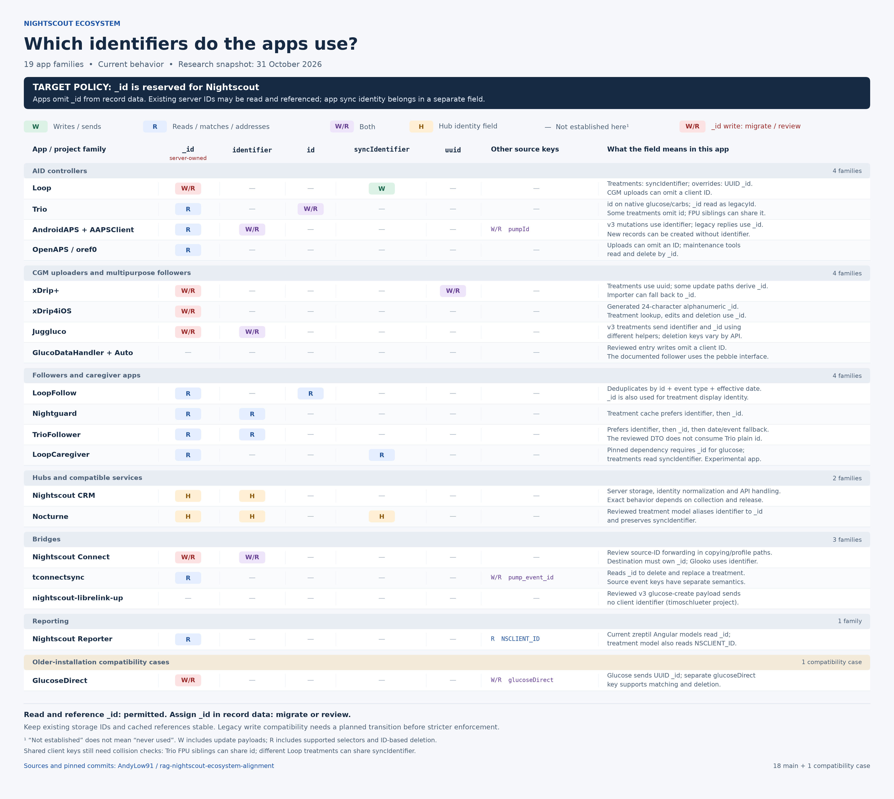

# Nightscout identifier compatibility across the main ecosystem apps

**Research snapshot: 31 October 2026. Contributor research in Andy Low's fork.**

The compatibility question reaches beyond Loop, Trio and AAPS. Uploaders choose client keys, followers use returned keys to match and deduplicate records, and bridges use them to replace or delete earlier uploads. A common field can simplify the ecosystem, but changing a field name, its value, its uniqueness rules or its lookup behavior are separate migrations.

The research inventory below covers **23 project families**, with two additional existing-installation cases. It is a practical audit scope, not a census of installations or a claim that every listed project has the same adoption. The updated graphic focuses on **19 families**. The [extended audit](ecosystem-identifier-compatibility-2026-10-31/extended-audit.md) retains other source findings without making every historical app a prerequisite for agreement.

**Adopted planning rule: `_id` is reserved for Nightscout.** Apps omit `_id` from uploaded record data; they may read and reference an existing server-assigned `_id` through a supported API. The [server owned identifier migration plan](../../40-migration/ecosystem-identifier-migration-plan-2026-10-31.md) records the target contract, legacy transition and acceptance criteria. The common client field's name and uniqueness rules remain separate coordination decisions.

## Identifier overview graphic

[Full resolution PNG](ecosystem-identifier-compatibility-2026-10-31/identifier-map.png) · [Editable SVG](ecosystem-identifier-compatibility-2026-10-31/identifier-map.svg)

The markers distinguish writes, reads and ID-based operations, and hub identity fields. Highlighted `_id` writes require migration or payload review against the target rule; read/reference use remains permitted. The chart shows observed behavior, not a whole-app compliance verdict. A dash means that use was not established in the reviewed paths; it does not assert that an app never uses the field.

iAPS, Sugarmate, JugglucoNG, Gluroo Global Connect, Home Assistant and the 600 Series Uploader have been removed from the graphic. Their research entries below are retained as part of the broader audit. The graphic contains 18 main families plus GlucoseDirect as an older-installation case.

## Relationship to Ben's research

This extends the existing research rather than changing the programme's decisions:

- [Identifier formats and per-app behavior](identifier-format-2026-10-17.md) covers opaque strings, generation, UUID quirks and ambiguity with ObjectId-shaped values.
- [Identifier duplicates](identifier-duplicates-2026-10-17.md) measures why an existing sync key cannot automatically become a unique record key.
- [Identity and resend survey](identity-resend-survey-2026-10-29.md) compares create, resend, update and delete behavior.
- [Consumer impact report](../../../reports/consumer-impact-15.0.9/clients-8758.md) and its [Trio note](../../../reports/consumer-impact-15.0.9/clients/ios/Trio.md) provide the earlier compatibility baseline.
- [Identifier conventions](../../30-design/platform/identifier-conventions.md), the [identity specification](../../30-design/platform/spec/identity.md), the [Loop identifier discussion](../../30-design/platform/upstream-asks-loop-identifier/README.md) and the [16.0.0 decisions](../../../releases/cgm-remote-monitor-16.0.0/decisions.md) remain the owning design and decision records.

The source review adds two particularly relevant details: **Trio's upload models differ from some of its download models**, and **LoopFollow actively uses Trio's plain `id` field for deduplication**. Neither is safely captured by a single field-name table alone.

## Identifier terms

| Term | Meaning and compatibility concern |
| --- | --- |
| `_id` | Reserved server-owned storage identity under the adopted plan. Apps may read and reference an existing value; they must not assign it in record data. Existing client uploads, including UUIDs and generated 24-character strings, need a documented compatibility transition. Cached server IDs remain usable. |
| `identifier` | API v3's exposed record identifier and the direction of the current common-client-key work. Its relationship to `_id` varies by API, server and historical data. It must not be assumed to be a UUID or universally independent of `_id` in today's ecosystem. |
| `id`, `syncIdentifier`, `uuid`, `NSCLIENT_ID` and source keys | Client or integration-specific fields. Some identify a logical source event or group rather than exactly one stored document. Equal spelling is not proof of equal semantics. |
| Authentication subject IDs | A separate domain. A token or subject `_id` is not evidence of treatment or glucose record identity. |

The API version also matters. Accepting an optional field on a v1 POST, requiring a returned identifier for a v3 PATCH, and requiring every future create to supply a client identifier are three different contracts. The [existing identity specification](../../30-design/platform/spec/identity.md) distinguishes current behavior from proposed constraints.

## Main ecosystem inventory

The selection uses current Nightscout documentation, public project activity and the integrations directly implicated by this discussion. Repository activity establishes maintenance evidence, not the number of people using a build. AAPSClient/NSClient is grouped with AAPS; GlucoDataAuto is grouped with GlucoDataHandler. Library dependencies and forks are not counted as additional independent user cohorts.

### AID controllers

| Project family | Relevant behavior | Compatibility focus and evidence |
| --- | --- | --- |
| [Loop](https://github.com/LoopKit/Loop) and [LoopWorkspace](https://github.com/LoopKit/LoopWorkspace) | Treatments use `syncIdentifier`; temporary overrides have UUID `_id` behavior. Internal CGM sync identifiers are not necessarily sent in uploaded entries. | Preserve the sync-key to server-ID cache used for edits/deletes. Some different treatment records share a sync key. See Ben's [format study](identifier-format-2026-10-17.md) and [duplicate study](identifier-duplicates-2026-10-17.md). |
| [Trio](https://github.com/nightscout/Trio) | Native glucose uploads use `id`; ordinary carb uploads use carb UUID `id`; FPU uploads use FPU UUID `id`. Several other treatment uploads omit it. | Preserve `find[id]` deletion and the existing `_id` legacy decoder. See the detailed Trio section below. |
| [AndroidAPS and AAPSClient](https://github.com/nightscout/AndroidAPS) | The v3 SDK uses `identifier` for entry/treatment mutation routes and maps server identity into local Nightscout IDs. The older NSClient path consumes `_id` acknowledgements. | Returned values and mutation routes matter as much as create payloads. [v3 routes](https://github.com/nightscout/AndroidAPS/blob/aa16db64196e570b15bf41e85422fc159c058308/core/nssdk/src/main/kotlin/app/aaps/core/nssdk/networking/NightscoutRemoteService.kt); [mapping](https://github.com/nightscout/AndroidAPS/blob/aa16db64196e570b15bf41e85422fc159c058308/plugins/sync/src/main/kotlin/app/aaps/plugins/sync/nsclientV3/extensions/BolusExtension.kt); [legacy acknowledgement](https://github.com/nightscout/AndroidAPS/blob/aa16db64196e570b15bf41e85422fc159c058308/plugins/sync/src/main/kotlin/app/aaps/plugins/sync/nsclient/acks/NSAddAck.kt). |
| [iAPS](https://github.com/Artificial-Pancreas/iAPS) | Its glucose model generates and encodes a UUID as `_id`; its treatment model uses plain `id`. | Keep the legacy UUID handling and download shape until this client migrates. [glucose](https://github.com/Artificial-Pancreas/iAPS/blob/6cb69e77ad5e2c05abc375cf30831eb9af56bb06/FreeAPS/Sources/Models/BloodGlucose.swift); [treatments](https://github.com/Artificial-Pancreas/iAPS/blob/6cb69e77ad5e2c05abc375cf30831eb9af56bb06/FreeAPS/Sources/Models/NightscoutTreatment.swift). |
| [OpenAPS and oref0](https://github.com/openaps/oref0) | Upload paths can omit a client ID; maintenance tooling reads and deletes by `_id`. | Older rigs remain a relevant compatibility case even when a default branch or release tag is old. [dedupe tool](https://github.com/openaps/oref0/blob/88cf032aa74ff25f69464a7d9cd601ee3940c0b3/bin/ns-dedupe-treatments.sh); Ben's [resend survey](identity-resend-survey-2026-10-29.md). |

### CGM uploaders and multipurpose followers

| Project family | Relevant behavior | Compatibility focus and evidence |
| --- | --- | --- |
| [xDrip+](https://github.com/NightscoutFoundation/xDrip) | Treatment writes carry `uuid`; lookup uses `find[uuid]`; some update paths derive a 24-hex `_id` from the UUID. Import can derive local UUID from returned `_id` when `uuid` is absent. | Keep both source UUID lookup and legacy server-ID continuity. [uploader](https://github.com/NightscoutFoundation/xDrip/blob/c42cf55c6b972215654bc2a34ce563c87a7aa594/app/src/main/java/com/eveningoutpost/dexdrip/utilitymodels/NightscoutUploader.java); [importer](https://github.com/NightscoutFoundation/xDrip/blob/c42cf55c6b972215654bc2a34ce563c87a7aa594/app/src/main/java/com/eveningoutpost/dexdrip/utilitymodels/NightscoutTreatments.java). |
| [xDrip4iOS](https://github.com/JohanDegraeve/xdripswift) | Generates 24-character alphanumeric IDs, sends glucose `_id`, and queries/updates/deletes treatments using `_id`. These generated values are not restricted to hexadecimal. | An empty lookup can mark a local treatment deleted; renaming the response field or changing lookup behavior can affect synchronization. [glucose payload](https://github.com/JohanDegraeve/xdripswift/blob/ba37f261352eedfb7f518c4a38e2266acb0f95e9/xDrip/Managers/Nightscout/BgReading%2BNightscout.swift); [generator](https://github.com/JohanDegraeve/xdripswift/blob/ba37f261352eedfb7f518c4a38e2266acb0f95e9/xDrip/Utilities/UniqueId.swift); [sync operations](https://github.com/JohanDegraeve/xdripswift/blob/ba37f261352eedfb7f518c4a38e2266acb0f95e9/xDrip/Managers/Nightscout/NightscoutSyncManager.swift). |
| [Juggluco](https://github.com/j-kaltes/Juggluco) | The v3 treatment serializer emits `identifier` and `_id` using separate generation helpers; v1 and v3 deletion use their corresponding keys. | Preserve the distinction between generated key forms and API versions. [treatment serialization and deletion](https://github.com/j-kaltes/Juggluco/blob/d8233ce3fe18ae57031a670c0c23677426733830/Common/src/main/cpp/net/watchserver/uploadtreatment.cpp). |
| [JugglucoNG](https://github.com/ctqvva/JugglucoNG) | Entry upload emits `identifier`. Treatment journal import considers `identifier`, `_id`, `id`, `NSCLIENT_ID` and `pumpId`; v3 updates remove immutable fields and address the record in the route. | This fork has additional behavior and needs its own checks. [entries](https://github.com/ctqvva/JugglucoNG/blob/11e6e29db7d9055c8fd2e96261812e16f2095f3d/Common/src/main/cpp/net/watchserver/uploader.cpp); [journal identity and mutation](https://github.com/ctqvva/JugglucoNG/blob/11e6e29db7d9055c8fd2e96261812e16f2095f3d/Common/src/mobile/java/tk/glucodata/data/journal/JournalTreatmentTransfer.kt). |
| [GlucoDataHandler](https://github.com/pachi81/GlucoDataHandler), including GlucoDataAuto | The reviewed glucose uploader constructs entries without a client identity field. The documented reader uses Nightscout's pebble interface. | A mandatory identifier on legacy creates would affect the uploader; a field rename alone has no demonstrated direct dependency in this path. [uploader](https://github.com/pachi81/GlucoDataHandler/blob/215b2f071f86942a5b9714cbf88808a71708a33f/mobile/src/main/java/de/michelinside/glucodatahandler/transfer/NightscoutUploader.kt); [Nightscout follower documentation](https://nightscout.github.io/nightscout/downloaders/). |

### Dedicated followers and caregiver apps

| Project family | Relevant behavior | Compatibility focus and evidence |
| --- | --- | --- |
| [LoopFollow](https://github.com/loopandlearn/LoopFollow) | Deduplicates treatments by plain `id` plus event type and effective date. Missing/empty `id` entries are retained. Treatment display identity also reads `_id`. | Removing `id` changes the dedupe input. Treating it as globally unique would collapse valid FPU siblings. [implementation](https://github.com/loopandlearn/LoopFollow/blob/4a74b781ad6836dd77eccc03bb08a42749dd59a6/LoopFollow/Controllers/Nightscout/Treatments.swift); [existing tests](https://github.com/loopandlearn/LoopFollow/blob/4a74b781ad6836dd77eccc03bb08a42749dd59a6/Tests/NightscoutTreatmentDeduplicationTests.swift); [display identity](https://github.com/loopandlearn/LoopFollow/blob/4a74b781ad6836dd77eccc03bb08a42749dd59a6/LoopFollow/Treatments/TreatmentsView.swift#L1163). |
| [Nightguard](https://github.com/nightscout/nightguard) | Treatment cache chooses `identifier`, falling back to `_id`. | Backfilling a new value can change the selected cache key even if `_id` remains present. [cache](https://github.com/nightscout/nightguard/blob/608be1b5484a177e143a7880040846926bd302fa/nightguard/domain/treatment/TreatmentsStream.swift). |
| [TrioFollower](https://github.com/t1dude/TrioFollower) | DTO stable IDs prefer `identifier`, then `_id`, then a date/event fallback. The reviewed DTO does not read Trio's plain `id`. | Preserve stable returned IDs for local deduplication, upserts and reconciliation. Do not infer that every Trio follower already uses `id`. [treatment DTO](https://github.com/t1dude/TrioFollower/blob/297e32fb99a8ba88c15ae3c45958693f81375d67/app/src/main/kotlin/com/trionsandroid/app/data/remote/TreatmentDto.kt); [repository](https://github.com/t1dude/TrioFollower/blob/297e32fb99a8ba88c15ae3c45958693f81375d67/app/src/main/kotlin/com/trionsandroid/app/data/nightscout/NightscoutRepositoryImpl.kt). |
| [LoopCaregiver](https://github.com/LoopKit/LoopCaregiver) | The pinned NightscoutKit dependency requires `_id` when decoding glucose and reads treatment `syncIdentifier`. | A relevant developing caregiver project; its README describes it as experimental. The dependency revision, rather than another similarly named library, is the evidence. [dependency lock](https://github.com/LoopKit/LoopCaregiver/blob/a6abd2e9b350b7eaeb33975c3803ba60ad113cc4/LoopCaregiver.xcworkspace/xcshareddata/swiftpm/Package.resolved); [glucose decoder](https://github.com/gestrich/NightscoutKit/blob/d63fb7370522f0dd441cd790aa960e991e118cda/Sources/NightscoutKit/Models/GlucoseEntry.swift); [treatment decoder](https://github.com/gestrich/NightscoutKit/blob/d63fb7370522f0dd441cd790aa960e991e118cda/Sources/NightscoutKit/Models/Treatments/NightscoutTreatment.swift). |
| [Sugarmate](https://sugarmate.io/) | Commercial follower listed in current Nightscout documentation. | Keep a black-box compatibility check for supported Nightscout source configurations. Public implementation evidence does not establish its identifier matching rules. [Nightscout follower documentation](https://nightscout.github.io/nightscout/downloaders/). |

### Hubs and compatible services

| Project family | Relevant behavior | Compatibility focus and evidence |
| --- | --- | --- |
| [Nightscout CRM](https://github.com/nightscout/cgm-remote-monitor) | Owns storage normalization, legacy UUID handling, API v1 compatibility and API v3 identifiers. Behavior varies by collection and release. | Test the shipping baseline and the target release separately. Use the [16.0.0 decisions](../../../releases/cgm-remote-monitor-16.0.0/decisions.md) and [resend survey](identity-resend-survey-2026-10-29.md) for the exact contract. |
| [Nocturne](https://github.com/nightscout/nocturne) | Its reviewed treatment model maps `_id` to `Id` and exposes `Identifier` as an alias of that `Id`; it also preserves `syncIdentifier`. The v3 controller addresses mutations by path identity. | An emerging hub must participate in alignment. These legacy/v3 model facts do not establish that every newer interface has identical semantics. [model](https://github.com/nightscout/nocturne/blob/9a86c550f8432a2d042a869d252c51f3ec6f7787/src/Core/Nocturne.Core.Models/Treatment.cs); [controller](https://github.com/nightscout/nocturne/blob/9a86c550f8432a2d042a869d252c51f3ec6f7787/src/API/Nocturne.API/Controllers/V3/TreatmentsController.cs). |
| [Gluroo Global Connect](https://gluroo.com/support/gluroo-global-connect-ggc-nightscout-compatible-api/) | A Nightscout-compatible service with a defined subset of functionality. Public documentation, rather than open application code, establishes its place in the inventory. | Treat GGC compatibility separately from Gluroo's outbound writer. Gluroo announced that **Write to Nightscout ends on 3 November 2026**, with GGC unaffected. [Official announcement](https://gluroo.com/blog/releases/gluroo-2-3-26-apple-watch-app-dexcom-g7-on-your-phone-ai-assistants-alexa-more/). |

### Bridges

| Project family | Relevant behavior | Compatibility focus and evidence |
| --- | --- | --- |
| [Nightscout Connect](https://github.com/nightscout/nightscout-connect) | Glooko mapping constructs non-UUID `identifier` values prefixed `glooko:`. Other source and profile paths retain or match existing IDs. | A UUID-only rule would reject established generated keys. Preserve profile matching as well as entries/treatments. [Glooko mapping](https://github.com/nightscout/nightscout-connect/blob/4dde1ecdcad1fd923e69d458e5e2faa7bc78e4f1/lib/sources/glooko/map.js); [profile sync](https://github.com/nightscout/nightscout-connect/blob/4dde1ecdcad1fd923e69d458e5e2faa7bc78e4f1/lib/outputs/profile-sync.js); [Nightscout source](https://github.com/nightscout/nightscout-connect/blob/4dde1ecdcad1fd923e69d458e5e2faa7bc78e4f1/lib/sources/nightscout.js). |
| [tconnectsync](https://github.com/jwoglom/tconnectsync) | User-mode synchronization reads `_id`, deletes an earlier treatment, then writes its replacement. Source pump-event keys are a separate field. | Read/delete/recreate must still address the same earlier record. [user-mode processor](https://github.com/jwoglom/tconnectsync/blob/4de47729c091f11e3265a4b21d0766bb201dfbc5/tconnectsync/sync/tandemsource/process_user_mode.py). |
| [nightscout-librelink-up](https://github.com/timoschlueter/nightscout-librelink-up) | Reviewed v3 glucose payload contains reading data and metadata without a client `identifier`. | A future mandatory-create rule needs an explicit transition; the current field-name debate does not prove a direct read dependency. [v3 payload](https://github.com/timoschlueter/nightscout-librelink-up/blob/bff2317f5cc0db4a1a40971bbf601c87ab0e856d/src/nightscout/apiv3.ts). |

### Reporting and automation

| Project family | Relevant behavior | Compatibility focus and evidence |
| --- | --- | --- |
| [Nightscout Reporter](https://github.com/zreptil/nightscout-reporter-angular) | Current Angular treatment/entry models read `_id`; the treatment model also reads `NSCLIENT_ID`. | Model consumption warrants regression checks, but does not by itself prove every report fails if a key changes. This is distinct from older projects with the same product name. [treatments](https://github.com/zreptil/nightscout-reporter-angular/blob/c21559a1fa20eb0ff24300f8b2a64563ee200136/src/app/_model/nightscout/treatment-data.ts); [entries](https://github.com/zreptil/nightscout-reporter-angular/blob/c21559a1fa20eb0ff24300f8b2a64563ee200136/src/app/_model/nightscout/entry-data.ts). |
| [Home Assistant official Nightscout integration](https://www.home-assistant.io/integrations/nightscout/) | Reads glucose through py-nightscout. The reviewed SGV model does not demonstrate an identifier-name dependency. | Keep as a main automation smoke test, rather than asserting a proven break from a rename. Independent custom v3 integrations have different requirements; see the appendix. [Integration source](https://github.com/home-assistant/core/tree/2026.10.4/homeassistant/components/nightscout); [SDK model](https://github.com/marciogranzotto/py-nightscout/blob/a4a87768173095d7d22745a06a015cf2202345a0/py_nightscout/models.py). |

## Existing installations that deserve explicit tests

| Project | Why retain it | Relevant identity behavior |
| --- | --- | --- |
| [GlucoseDirect](https://github.com/creepymonster/GlucoseDirect) | Public source remains relevant to existing installations despite an old GitHub latest-release record. | Generates UUID `_id` for glucose, carries `glucoseDirect` as a separate key, and deletes using `find[glucoseDirect]`. Sensor-start IDs also have their own derivation. [implementation](https://github.com/creepymonster/GlucoseDirect/blob/ffe5500a010f0e14adef0653047c9d9f8cf550d7/App/Modules/Nightscout/Nightscout.swift). |
| [600 Series Android Uploader](https://github.com/pazaan/600SeriesAndroidUploader) | Repository is archived, but current [Nightscout uploader documentation](https://nightscout.github.io/uploader/uploaders/) still describes it for older Medtronic pumps. | Uses `key600` and `pumpMAC600` alongside `_id`; matching and deletion are distinct steps. [endpoints](https://github.com/pazaan/600SeriesAndroidUploader/blob/6a4048c5ae2a1707234dec6b1c3c15228b29496d/app/src/main/java/info/nightscout/android/upload/nightscout/TreatmentsEndpoints.java). |

Spike, Glimp and Diabox are explicitly marked legacy in current [Nightscout follower documentation](https://nightscout.github.io/nightscout/downloaders/). The unmaintained StephenBlackWasAlreadyTaken/NightWatch repository must not be confused with the separately listed current Play Store Nightwatch app. These cases do not expand the primary coordination list. Other commercial followers, watch faces, small bridges and historical copies remain outside the code-audited main scope.

## What Trio is doing now

Trio changed its native upload behavior in [commit 149e3bb, dated 24 March 2026](https://github.com/nightscout/Trio/commit/149e3bb71fd17e994ad5c55a8e2a050133dbac2e), titled “No longer push _id to NS; decode as legacyId”. The relevant paths were rechecked on main at `0b29cd53415e7f0e668677749cad8daf81c68c2f` and dev at [`ccb00bb7`](https://github.com/nightscout/Trio/tree/ccb00bb7bd277c4abcc7ba2f364725510bbe2592), as of this snapshot.

| Path | Current upload or lookup behavior |
| --- | --- |
| Native glucose | Encodes its client UUID as `id`; decodes `_id` separately as `legacyId`. [model](https://github.com/nightscout/Trio/blob/0b29cd53415e7f0e668677749cad8daf81c68c2f/Trio/Sources/Models/BloodGlucose.swift). |
| Ordinary carbohydrate treatment | Converts the stored carb into `NightscoutTreatment` and assigns `id = result.id?.uuidString`. [upload conversion](https://github.com/nightscout/Trio/blob/0b29cd53415e7f0e668677749cad8daf81c68c2f/Trio/Sources/APS/Storage/CarbsStorage.swift). |
| FPU carbohydrate treatment | Assigns `id = result.fpuID?.uuidString`. Multiple time-separated siblings can share the FPU identity. Same conversion source above; the consumer expectation is also explicit in [LoopFollow tests](https://github.com/loopandlearn/LoopFollow/blob/4a74b781ad6836dd77eccc03bb08a42749dd59a6/Tests/NightscoutTreatmentDeduplicationTests.swift). |
| Temporary targets and other treatment uploads | Some constructors omit `id`; they must not be described as if every treatment now sends a UUID. [temporary target conversion](https://github.com/nightscout/Trio/blob/0b29cd53415e7f0e668677749cad8daf81c68c2f/Trio/Sources/APS/Storage/TempTargetsStorage.swift); [optional treatment ID](https://github.com/nightscout/Trio/blob/0b29cd53415e7f0e668677749cad8daf81c68c2f/Trio/Sources/Models/NightscoutTreatment.swift). |
| Carb and insulin deletion | API v1 query deletion uses `find[id][$eq]`. Glucose deletion has ID/date fallback behavior. [API operations](https://github.com/nightscout/Trio/blob/0b29cd53415e7f0e668677749cad8daf81c68c2f/Trio/Sources/Services/Network/Nightscout/NightscoutAPI.swift). |

The carb and temporary-target **download** models still contain `_id` coding keys. Their presence is not evidence that the final converted upload payload still writes a UUID into `_id`. Trio remains a v1 client in these paths; this is not an adoption of a universal `identifier` field or an API v3 migration.

LoopFollow's dedupe tuple is **`id`, event type, effective date**. Its existing tests preserve same-ID FPU treatments at different times. A migration that simply promotes every Trio `id` into a unique per-document `identifier` would need to resolve those siblings first. Removing `id` while retaining only the new field would also change the reviewed follower's dedupe behavior.

## Context from the Discord discussion

The user supplied a transcript of the late October discussion. The points relevant to this audit are:

- Ben distinguishes a server-owned `_id` from a common client field, with `identifier` the current direction. Optional adoption and a future mandatory contract were discussed separately.
- Trio's developer describes having already changed to `id` following earlier feedback, and raises the migration cost for existing data and consumers.
- Pete suggests an optional unique client attribute with query, insert and upsert behavior as a simpler path.
- A shared naming choice and backward compatibility remain the practical coordination problem. App popularity is not a measure of compatibility impact.

The transcript does not contain the complete earlier agreement and has no public message permalink. It therefore cannot establish that Ben previously required the literal name `id`, or that all projects agreed to a final replacement. This summary records the technical issues; the raw private transcript is not reproduced here.

## Compatibility risks and proposed transition

The `_id` ownership rule is adopted for planning in this fork through the [migration plan](../../40-migration/ecosystem-identifier-migration-plan-2026-10-31.md). The other client-field and rollout choices below remain recommendations for discussion; they do not amend Ben's decision records or establish project-wide maintainer sign-off.

| Change under consideration | Clients or patterns to check | Required migration question |
| --- | --- | --- |
| Remove or rename returned `_id` | xDrip4iOS, iAPS, LoopCaregiver's decoder, reporter models, older maintenance tools | Can existing builds still decode, find and delete the same records? |
| Remove Trio `id` | Trio's deletion filters and LoopFollow's dedupe tuple | How do old clients address historic data, and how are FPU siblings preserved? |
| Copy every legacy sync key into a unique canonical field | Shared Trio FPU IDs and Loop treatment sync keys | Does the source key identify exactly one record in the collection? What is the collision/backfill policy? |
| Introduce a new canonical value on existing rows | Nightguard and TrioFollower prefer `identifier` over `_id` | Will caches treat the old row as a new record, or will an alias/reconciliation path preserve continuity? |
| Require a UUID or MongoDB-generated ObjectId | xDrip4iOS, Connect, Juggluco, pump-derived keys, synthetic keys in the appendix | Which current opaque values would be rejected or misinterpreted? |
| Require a client identifier on every create | Loop CGM, OpenAPS, GDH, LibreLinkUp and other no-ID uploaders | Which API/release boundary makes this mandatory, and how do legacy writers continue? |
| Change by-ID matching or resend behavior | AAPS v3, Juggluco v3, cached Loop IDs and bridge deletion/replacement | Does each collection retain its specified update, replacement, merge and delete semantics? |

During the documented legacy transition, preserve existing client fields, aliases and lookup behavior. Updated clients omit `_id` from record data and keep supported references to existing storage IDs in routes or selectors. The eventual common-client-key contract needs to define precedence when fields disagree, uniqueness per collection, stable retry behavior, how IDs are derived across devices, and how old cached values remain addressable. Backfill should preserve aliases where needed rather than silently changing the identity returned to existing clients. Stricter enforcement follows an explicit API or release boundary in the [migration sequence](../../40-migration/ecosystem-identifier-migration-plan-2026-10-31.md#migration-sequence).

The new field's **name does not settle its semantics**. UUID-only validation is a separate decision; Ben's [format study](identifier-format-2026-10-17.md) already documents non-UUID values. Likewise, a source event key must not become a unique document key until duplicate analysis establishes that the mapping is valid.

Server changes should be assessed against a named release and collection contract. [CRM PR 8859](https://github.com/nightscout/cgm-remote-monitor/pull/8859) being merged into dev is not proof that every production deployment implements the target design. Use the [release decisions](../../../releases/cgm-remote-monitor-16.0.0/decisions.md) rather than assuming all collections merge or replace in the same way.

## Proposed acceptance cases

Use synthetic fixtures across the shipping baseline and target server, including old and new client payloads. Also apply the [ownership policy acceptance criteria](../../40-migration/ecosystem-identifier-migration-plan-2026-10-31.md#acceptance-criteria-for-the-ownership-policy):

1. Trio glucose `id` plus legacy `_id` decoding; ordinary carb retry and deletion by `id`.
2. Two Trio FPU siblings with the same `id` and different times, plus a true duplicate of one sibling. LoopFollow must keep the siblings and remove only the duplicate.
3. Loop treatment sync-key collisions across record/event types, followed by an edit/delete using the cached returned server ID.
4. xDrip4iOS non-hex 24-character IDs and a lookup that returns no matching treatment; confirm the local deletion decision remains correct.
5. xDrip+ `uuid` lookup and derived `_id` update/delete, with and without a returned `uuid`.
6. iAPS and GlucoseDirect UUID `_id` writes through the legacy normalization path, then lookup/delete using the old key.
7. AAPS v3 and Juggluco v3 create/read/PATCH/DELETE cycles, including response identifiers and the legacy NSClient acknowledgement shape.
8. Nightguard and TrioFollower caches populated before backfill, then polled after a canonical identifier is added; no duplicate, stale or accidentally removed records.
9. LoopCaregiver glucose decoding with its pinned dependency, plus Nightscout Reporter treatment/entry parsing.
10. No-ID entry writes from Loop/OpenAPS/GDH/LibreLinkUp, including retries; separately check any proposed future mandatory interface.
11. Connect non-UUID keys and profile sync; tconnectsync delete/recreate; 600-series source-key lookup followed by `_id` deletion.
12. Conflicting old/new identity fields, pre-existing duplicate source keys, arbitrary opaque strings, and ObjectId-shaped values. Verify unambiguous routing and the documented precedence rule.

Sugarmate and GGC need black-box checks of their supported configurations. Nightscout Pro's own clients, connectors and support tooling should have a separate internal acceptance inventory; this public audit does not establish which internal deployments use which key. None of the cases above is claimed as an executed cross-app migration test.

## Evidence and maintenance

Pinned source links identify the exact code reviewed; [sources.json](ecosystem-identifier-compatibility-2026-10-31/sources.json) lists those commits and files. [Current project signals](ecosystem-identifier-compatibility-2026-10-31/project-signals.json) preserve the public metadata snapshot used for scope, with stars omitted because they are not an adoption measure. GitHub's latest-release endpoint is not a universal current-version source: rolling tags, development builds and workspace releases differ.

The main scope combines source-reviewed projects with explicitly marked documentation-only services. Model declarations establish field consumption; they do not alone establish runtime failure. Expected migration effects above are acceptance questions derived from those paths, rather than measured production incidents. Expand the inventory when a concrete compatibility dependency appears; keep unverified discovery hits and dormant copies out of the primary coordination scope.
